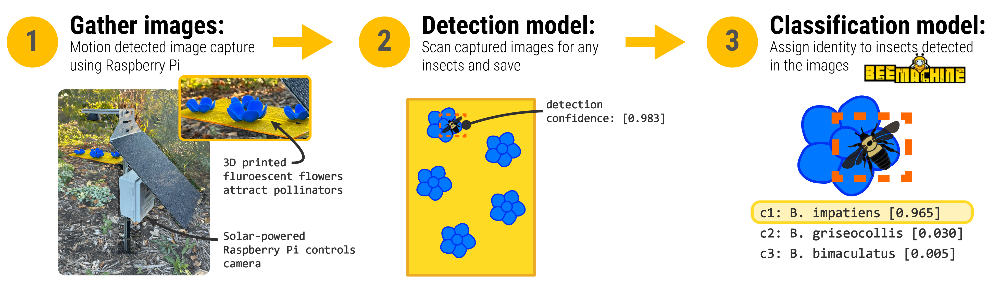
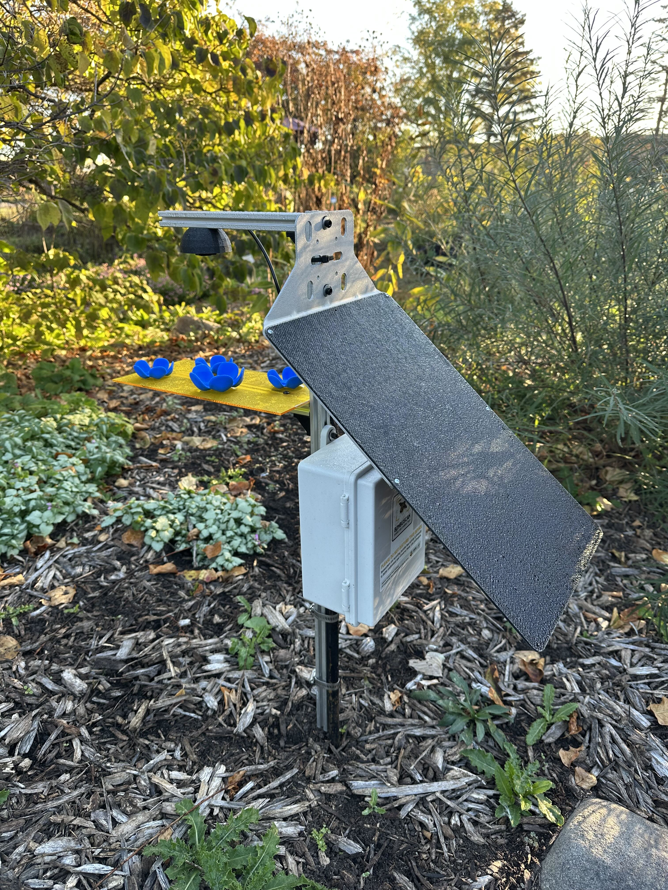
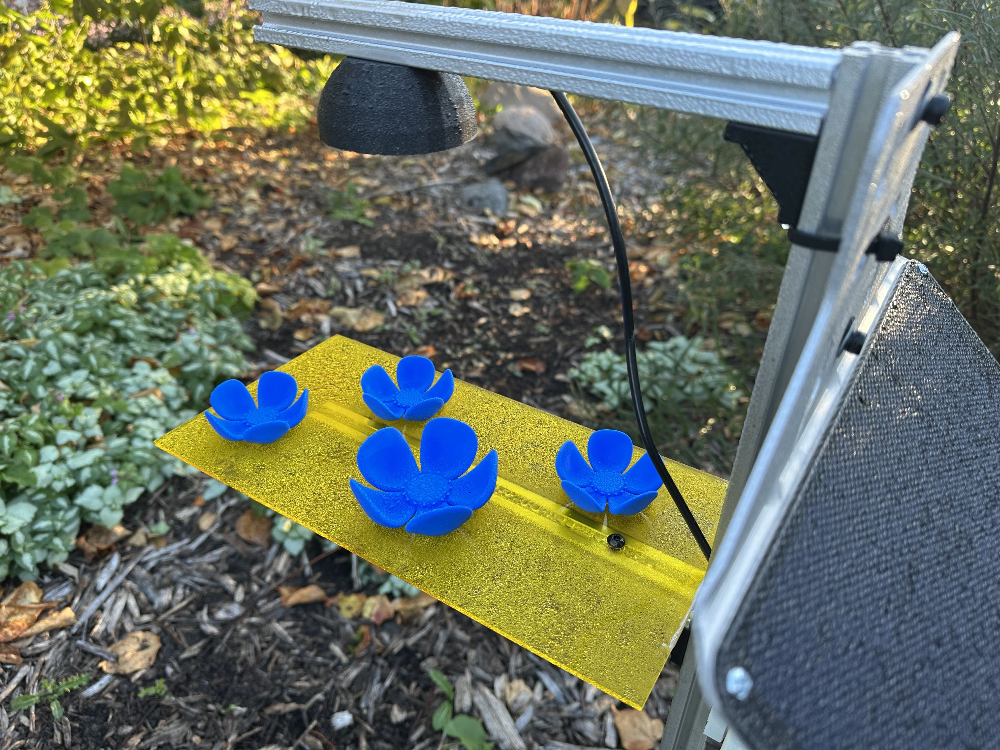
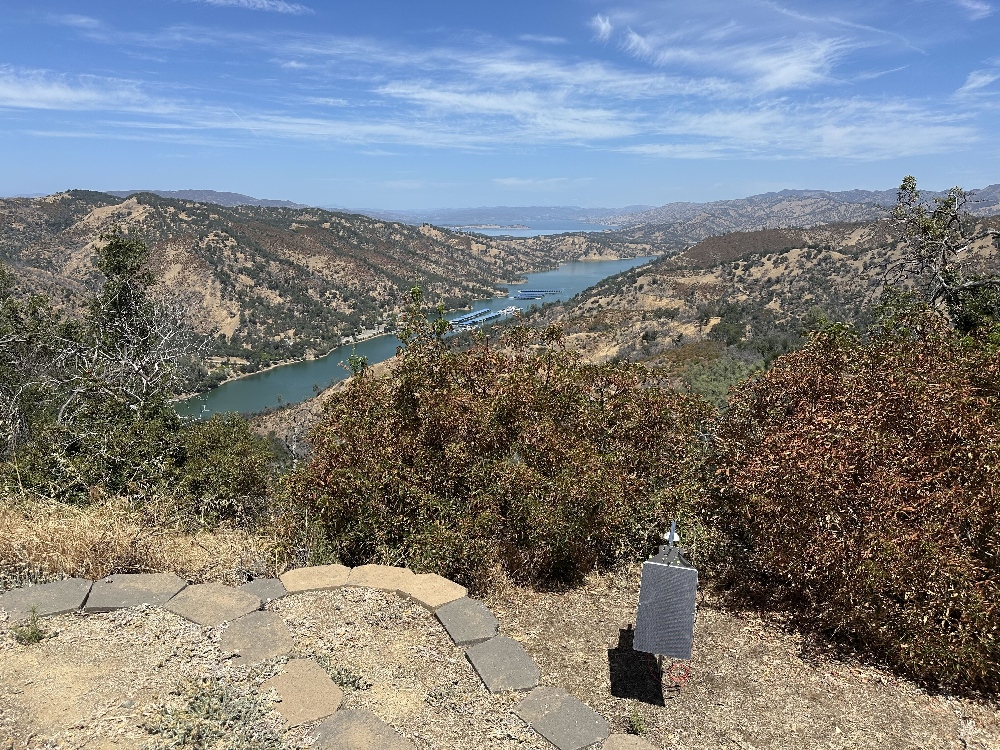

:::: {.video-hero}
```{=html}
<video autoplay loop muted playsinline>
  <source src="media/about/bumbles.mov" type="video/quicktime">
  Your browser does not support the video tag.
</video>
<div class="hero-overlay"></div>
```

::: {.hero-content}
# Getting continuous data of bumble bee and pollinator activity
<p class="white-text">
Our cameras give us data at an unprescedented resolution of time and space, allowing us to address pressing questions about the drivers of bumble bee and pollinator populations.
</p>
:::
::::

</br>

::::{.research-callout1}
:::{.callout-header}
###  How do they work?
:::

</br>

{width="95%" fig-align="center"}

:::{.callout-body}
 Our camera trap works pretty much like a commercial trail cam would, but with the camera trained on a surface containing fluorescent, artificial flowers that attract bumble bees and other pollinators. When an insect lands, the camera, controlled by a Raspberry Pi miniature computer, detects motion and triggers a 3-image burst. 

</br>

 We gather the images and process them using an insect detection computer vision model. This scans each image and crops out areas where the model believes there is an insect. Those crops are passed on to a classification model.

</br>

 We then use an amazing tool called [BeeMachine](https://www.beemachine.ai/) developed by [Brian Spiesman](pollinatorlab.com) at Kansas State University. This is a *classification* model that assigns a taxonomic identity to the insects detected, providing a confidence score (between 0-1) for the top 3 classes. The model is able to ID bumble bees with 94% accuracy and has the capacity to ID almost 1,200 other flower visiting insect groups including 999 bee specices and 154 bee genera (and other groups like wasps, flies, beetles, and butterflies and moths). 

</br>

 The trap design is formed from an amalgam of prototypes, including work from our lab and some awesome work from researchers at Oregon State University. We've made adjustments to the trap attract surface and made ours solar powered to be able to collect data continously for the entire growing season.
:::

:::{.callout-body .button-row}
[ Check out BeeMachine](https://www.beemachine.ai/){.btn .btn-primary role="button"} 

[ Check out Oregon State paper](https://zslpublications.onlinelibrary.wiley.com/doi/10.1002/rse2.70091){.btn .btn-primary role="button"} 

[ See our build plans](https://github.com/ibug-lab/bombuscam){.btn .btn-primary role="button"} 
:::
::::

</br>

:::::{.research-callout1}
:::{.callout-header}
###  What do they look like in the field?
:::

::::{.callout-body}
::: {layout="[1,1,1,1]"}
{.lightbox .uniform-gallery description="BombusCam deployed at the University of Minnesota for testing."}

{.lightbox .uniform-gallery description="Closeup of the trap surface with 3D printed fluorescent flowers. These 'glow' under UV light and serve to attract specifically bumble bees."}

{.lightbox .uniform-gallery description="BombusCam deployed at Cedar Creek Reserve in conjunction with EEB researchers to investigate impacts of air quality on pollinator activity."}

{.lightbox .uniform-gallery description="BombusCam deployed at Quail Ridge Reserve overlooking Lake Berryessa outside of Winters, CA -- part of the UC Reserve system."}
:::
::::

:::::

</br>

::::{.research-callout1}
:::{.callout-header}
###  What do the 🐝 photos look like?
:::

::::{.callout-body}
::: {layout="[1,1,1,1]"}

:::
::::

::::