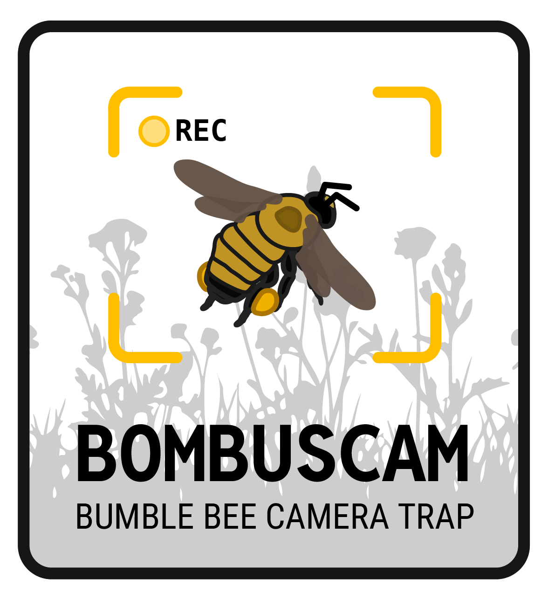

```{=html}
<style>
  body {
  background-image: url("https://jhemberger.github.io/images/photography/insects/2018_GooseBumble-10.jpg");
  box-shadow: inset 0 0 0 1000px rgba(0,0,0,.6);
  background-size: cover;
  background-repeat: no-repeat;
  background-position: 60% center;
}
</style>
```

{width="30%"}

<p class="white-text">
The `BombusCam` is an automated camera trap designed to provide continuous, non-lethal monitoring of bumble bee (and other pollinator) biodiversity. It functions not unlike a trail camera does for monitoring vertebrate and game species, letting us document species diversity and understand how environmental conditions impact bumble bee activity and species persistence. We're developing these tools with collaborators at <a data-original-href="https://pollinatorlab.com/" href="https://pollinatorlab.com/" class="white-text">Kansas State University</a> and the <a data-original-href="https://serdp-estcp.mil/" href="https://serdp-estcp.mil/" class="white-text">Environmental Security Technology Certification Program (ESTCP)</a>
</p>