 

:::::{.research-callout1}
:::{.callout-header}
###  Air quality impacts on bumble bee activity
:::

::::{layout="[0.25, 0.75]"}
:::{.callout-body}
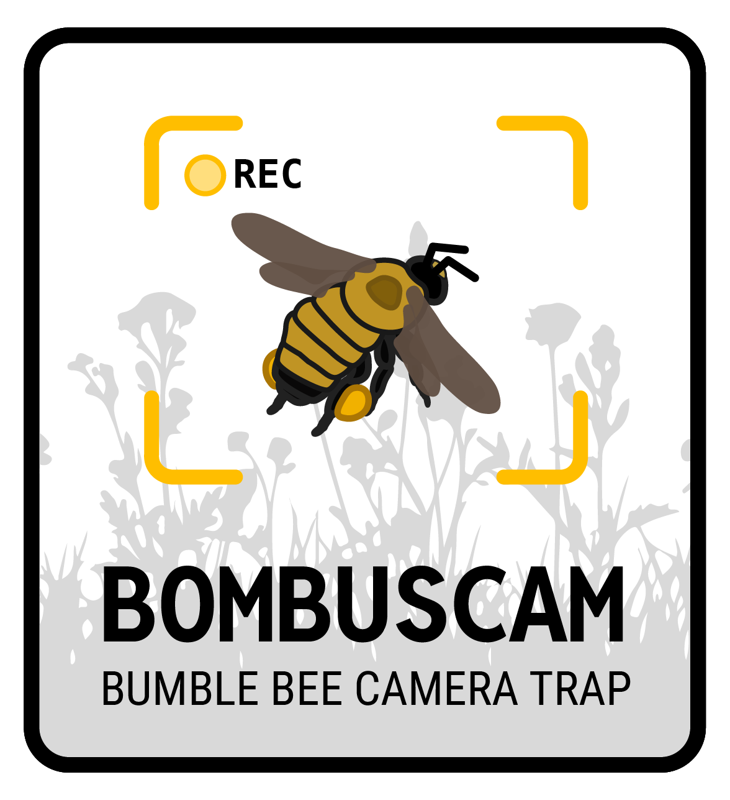{width="200px" fig-align="center"}
:::

:::{.callout-body}
Air pollution from wildfire smoke is an increasing threat to biodiversity and planetary health. Minnesota has experienceed a significant increase in wildfire smoke events in the last five years, and our knowledge of how these events impact important ecosystem functions like pollination is almost entirely unknown. The little we do know suggests that smoke may impede pollinator's ability to navigate when flying. We've been coupling the BombusCam camera traps with air pollution sensors to determine if there is a link between decreased pollinator activity and air quality. This past summer, we also had interns in our Science Deep Dive youth research program working with these data in almost real-time data and we've also partnered with the Bell Museum, utilizing their outdoor research space to collect data, and to host a workshop for youth interns on science communication to develop materials for sharing this research to the public.
:::
::::

::::{.callout-body}
::: {layout="[1,1,1]"}
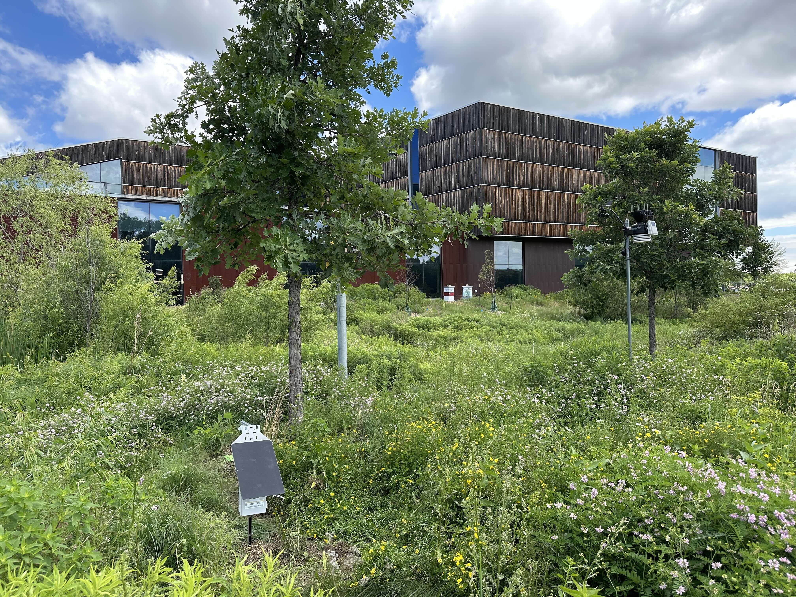{.lightbox .uniform-gallery description="Massive sunflower hybrid seed production field outside of Davis, CA."}

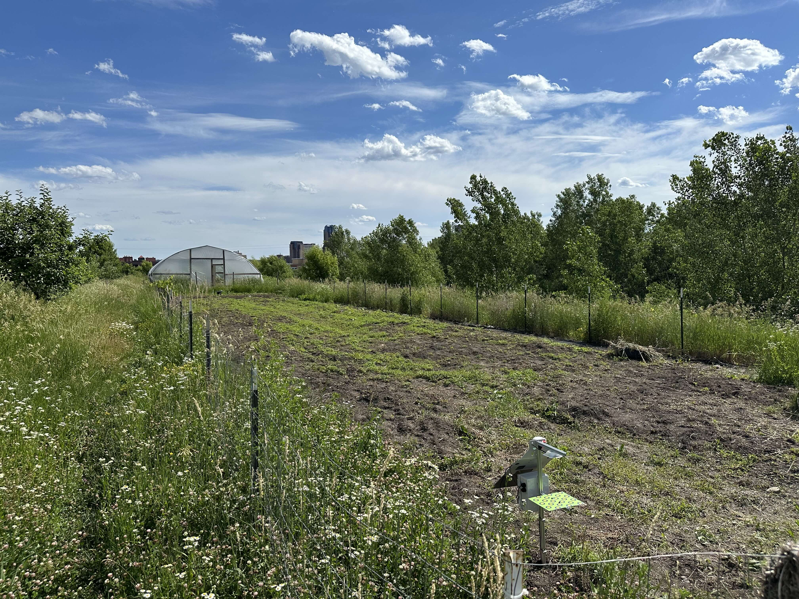{.lightbox .uniform-gallery description="Pollin*Cam unit deployed in sunflower field outside of Davis, CA."}

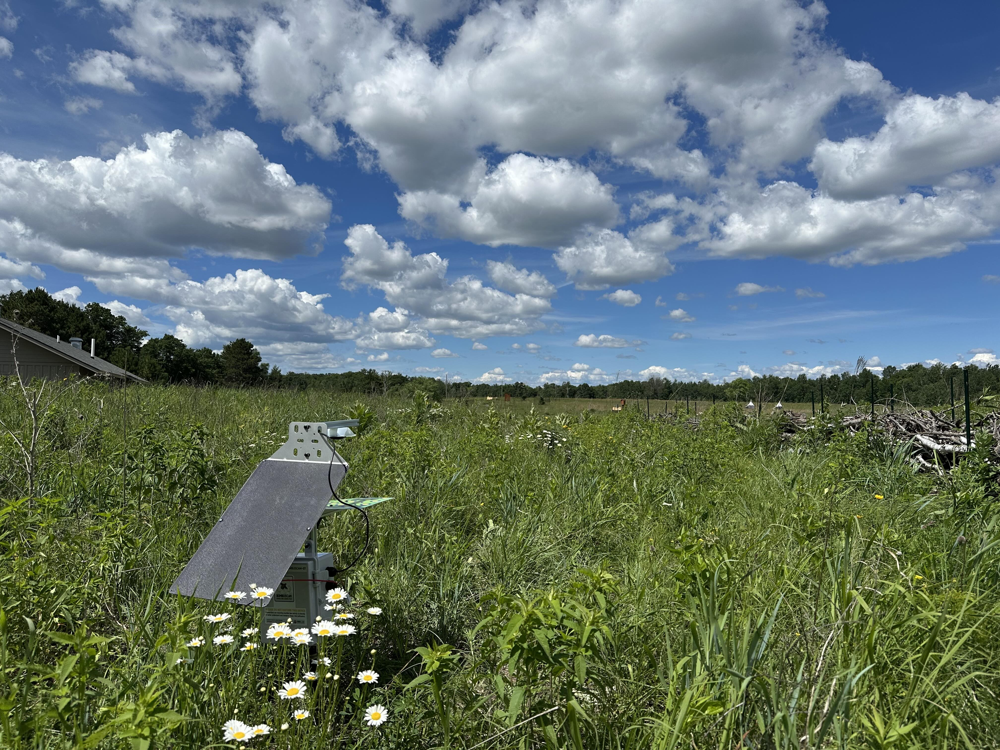{.lightbox .uniform-gallery description="Pollin*Cam unit deployed in sunflower field outside of Davis, CA."}
:::
::::

::::{.callout-body .sponsor-grid}
::: {.sponsor-logos-row}
{.lightbox .uniform-gallery}
:::
::::
:::::

 

:::::{.research-callout1}
:::{.callout-header}
###  Heat wave impacts on sunflower & crop pollination
:::

::::{layout="[0.33, 1]"}
:::{.callout-body}
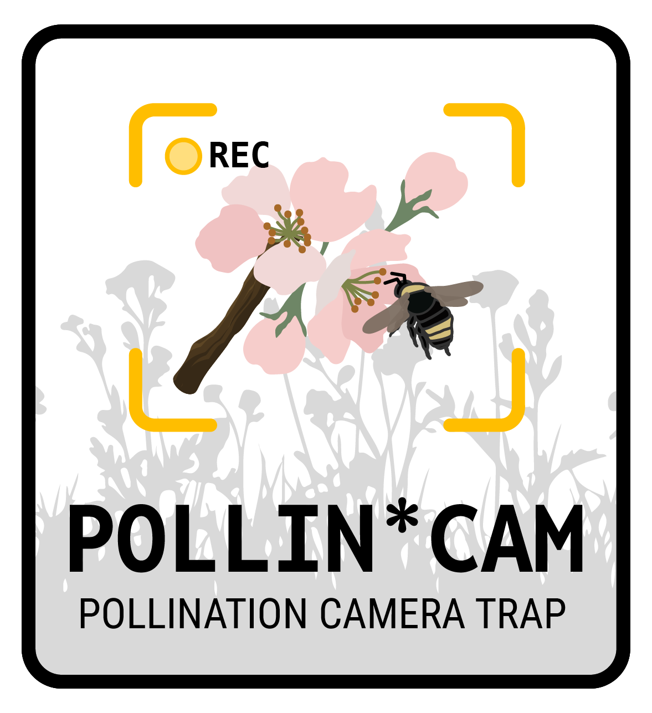{width="200px" fig-align="center"}
:::

:::{.callout-body}
One huge advantage of using cameras to continuously monitor bee activity is that we can understand how acute, stochastic environmental disturbances impact important ecosystem functions like pollination. Heat waves are one such disturbance. We've been working with collaborators at UC Davis to measure pollinator responses to heat waves so that we can model their potential impact on insect-mediated pollination of crops, using sunflowers as a model system. This project has been ongoing since 2021, but has recently been funded by a new California Department of Food and Agriculture (CDFA) Specialty Crop grant. For this project, we've been using a modified version of the BombusCam, called the Pollin*Cam, to monitor bee activity on sunflowers rather than an artificial lure. 
:::
::::

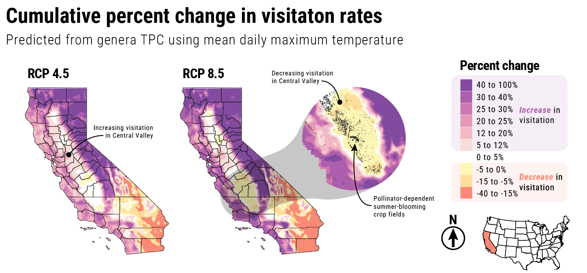{.lightbox width="85%" fig-align="center"}

::::{.callout-body}
::: {layout="[1,1,1]"}
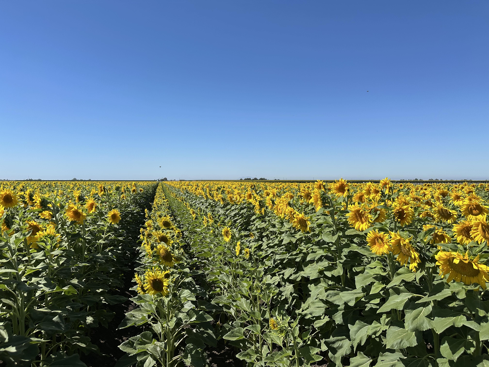{.lightbox .uniform-gallery description="Massive sunflower hybrid seed production field outside of Davis, CA."}

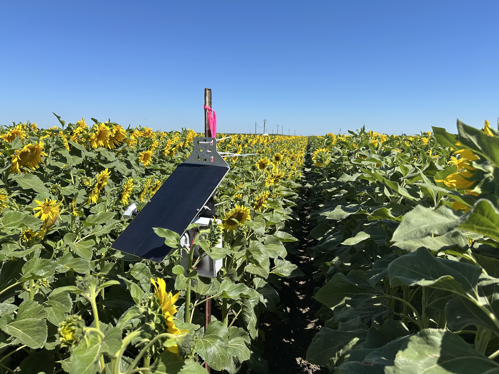{.lightbox .uniform-gallery description="Pollin*Cam unit deployed in sunflower field outside of Davis, CA."}

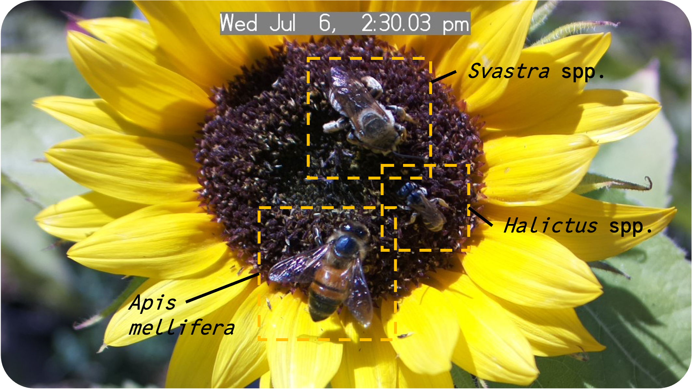{.lightbox .uniform-gallery description="Example image from a deployed unit in 2022, with 3 different sunflower pollinators visiting simultaneously."}
:::
::::

::::{.callout-body .sponsor-grid}
::: {.sponsor-logos-row}
{.lightbox .uniform-gallery}

{.lightbox .uniform-gallery}

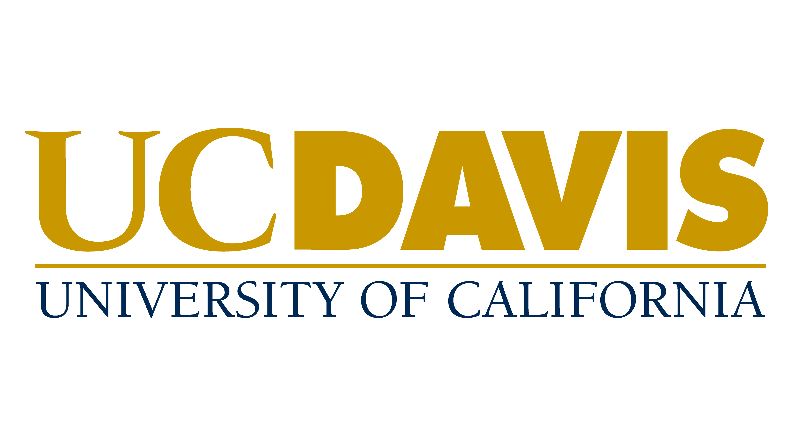{.lightbox .uniform-gallery}
:::
::::
:::::

 

:::::{.research-callout1}
:::{.callout-header}
###  Long-term monitoring of bumble bee populations
:::

::::{layout="[0.25, 0.75]"}
:::{.callout-body}
{width="200px" fig-align="center"}
:::

:::{.callout-body}
Bumble bees are a critically important group of insect pollinators wherein several species have experienced extensive declines in range and abundance, with federal and state protection pending for several species in addition to the currently endangered Rusty Patched bumble bee (*Bombus affinis*). Despite this, our understanding of bumble bee population trends is largely piecemeal due to a lack of long-term monitoring efforts. This project, ongoing since 2024, has established a long-term bumble bee monitoring effort across the historical and current range of the Rusty Patched bumble bee in the Upper Midwest. Part of this involves establishing BombusCam camera traps across our monitoring sites to compare against human-based methods with the hope of establishing the cameras as a permanent fixture in bumble bee monitoring efforts. 
:::
::::

::::{.callout-body}
::: {layout="[1,1,1,1]"}
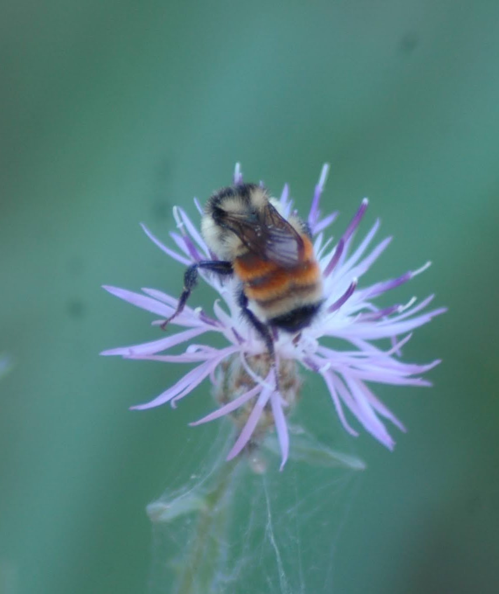{.lightbox .uniform-gallery description=""}

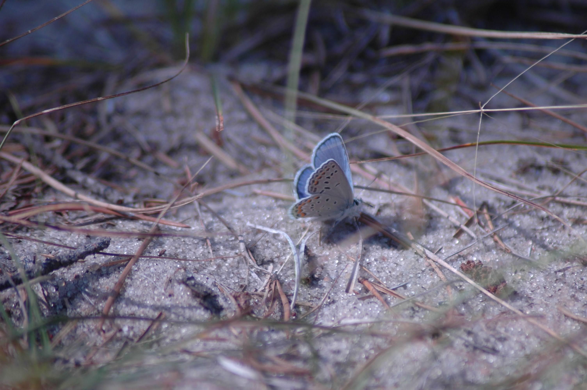{.lightbox .uniform-gallery description=""}

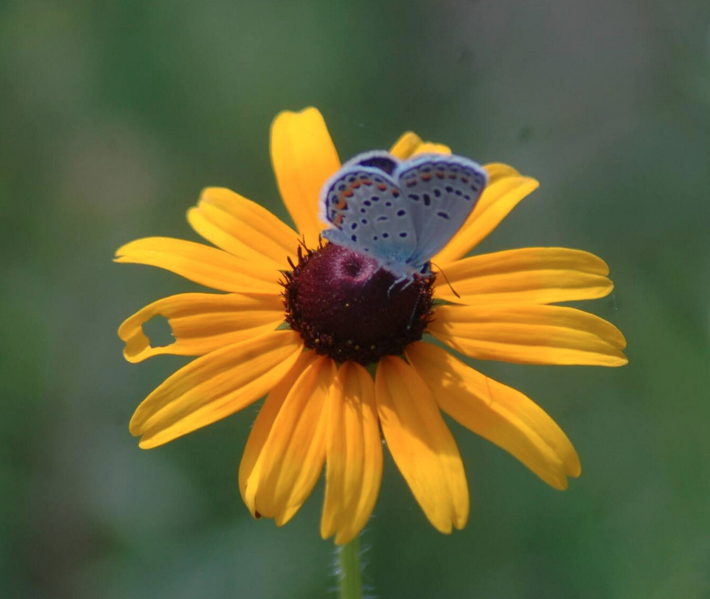{.lightbox .uniform-gallery description=""}

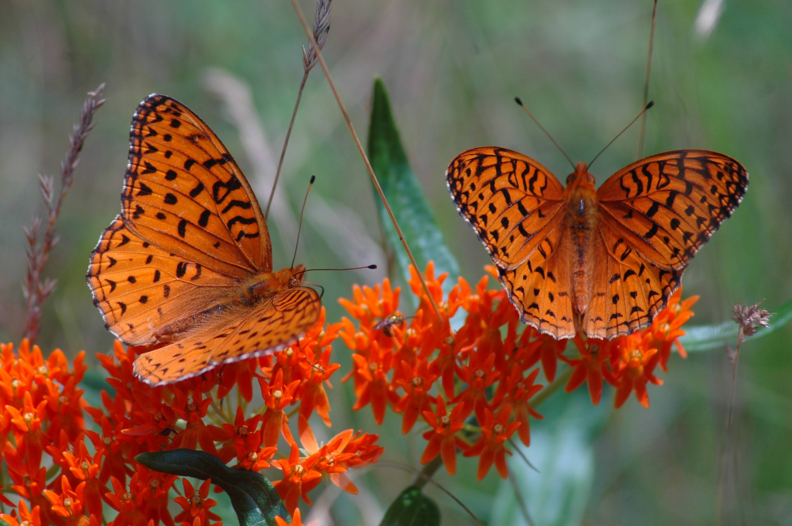{.lightbox .uniform-gallery description=""}
:::
::::

::::{.callout-body .sponsor-grid}
::: {.sponsor-logos-row}
{.lightbox .uniform-gallery}

{.lightbox .uniform-gallery}
:::
::::
:::::